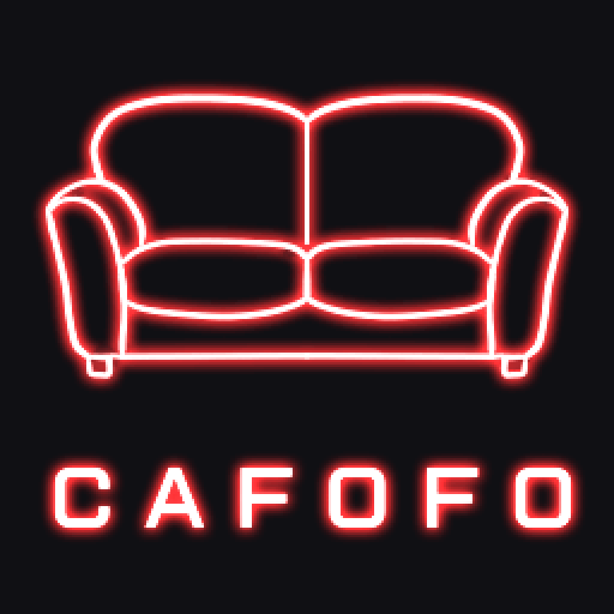

<p align="center">
  
</p>

<h1 align="center">Cafofo</h1>

<p align="center">
  Voz, chat, transmissão de tela e música com a galera — sem comer metade da sua RAM no meio da partida.
</p>

<p align="center">
  <a href="https://cafofo-landing.pages.dev"><strong>Baixar para Windows</strong></a>
  &nbsp;·&nbsp;
  <a href="https://cafofo.pages.dev"><strong>Abrir no Navegador</strong></a>
</p>

---

## A ideia

O Cafofo nasceu da vontade de ter um lugar nosso pra colar em call de madrugada, transmitir o jogo, ouvir música junto e personalizar o perfil do jeito que a gente quiser — sem paywall pra trocar um banner e sem depender de cliente pesado comendo CPU atrás do jogo.

Hoje ele roda tanto como **app desktop no Windows** (Tauri v2 + Rust, com bandeja do sistema, autostart e atualização automática) quanto direto no **navegador**.

## O que já funciona

- **Salas de voz e texto:** servidores com convite, canais de texto em tempo real, cargos, DMs e chamadas 1:1.
- **Palco de transmissões 16:9:** compartilhe a janela do jogo ou a tela inteira com áudio e controle de volume separado por pessoa e por stream (0% a 200%).
- **Bot de música sincronizado:** busca e fila do YouTube sincronizadas com a sala de voz inteira, com cache em disco no servidor pra faixa começar junto do `0:00`.
- **Perfil com a sua cara:** avatar e banner recortáveis, temas de cartão, molduras, stickers e som de entrada de até 3 segundos quando você entra na call.
- **Game Detector (Windows):** detecta automaticamente o jogo aberto no PC (e deixa cadastrar jogos customizados) pra mostrar no seu perfil.
- **Experiência nativa no desktop:** barra de título integrada, minimizar para a bandeja sem derrubar a call, iniciar silenciosamente com o Windows e auto-update assinado via Cloudflare R2.

## Como o projeto está organizado

```text
apps/
  desktop/     Frontend React + Vite e shell nativo Tauri v2 (Windows)
  landing/     Página de download conectada ao latest.json no Cloudflare R2
  server/      Servidor Axum (sinalização WebSocket, tokens LiveKit e bot de música)
crates/
  audio-engine/     Captura de áudio e DSP em Rust
  game-detector/    Detecção de processos/jogos no Windows
  protocol/         Contratos compartilhados Rust <-> TypeScript (ts-rs)
  screen-capture/   Listagem de janelas e extração de ícones no Windows
packages/
  core-logic/  Stores Zustand, cliente Supabase e cliente de sinalização
supabase/
  migrations/  Schema Postgres, RLS e buckets de storage
scripts/       Scripts PowerShell de dev, migrations, deploy e release
```

### Stack principal

- **Desktop & Web:** Tauri v2, React 19, TypeScript, Tailwind CSS, Zustand, Radix UI
- **Áudio & Vídeo:** LiveKit (WebRTC) + servidor próprio de sinalização em Rust (Axum)
- **Dados & Auth:** Supabase (Postgres, Auth, Realtime, Storage)
- **Infra:** Fly.io (`gru`) para o servidor Rust, Cloudflare Pages para web/landing e Cloudflare R2 para os releases assinados

## Rodando na sua máquina

Você vai precisar de:

- **Node.js** com Corepack (`pnpm@9.15.0`)
- **Rust** (`rustup` / `cargo`)
- Um projeto no **Supabase** e credenciais do **LiveKit** (local ou LiveKit Cloud)

1. Copie o template de variáveis de ambiente e preencha suas chaves:

```powershell
cp .env.example .env
cp apps/desktop/.env.example apps/desktop/.env
```

2. Instale as dependências e suba o ambiente local (servidor + frontend):

```powershell
corepack pnpm install
corepack pnpm dev:all
```

Para abrir direto na janela desktop (Tauri):

```powershell
corepack pnpm dev:desktop
```

## Build, testes e release

```powershell
# Checagem de tipos e testes do servidor
corepack pnpm typecheck
cargo check --workspace
cargo test -p cafofo-server

# Compilar instalador Windows assinado (.exe + .sig)
corepack pnpm build:exe

# Gerar nova versão e publicar no Cloudflare R2
corepack pnpm release
```

> Os arquivos `.env`, `.env.production` e a chave privada de assinatura (`%USERPROFILE%\.tauri\cafofo.key`) ficam fora do repositório. Veja `.env.production.example` para o formato de produção.

## Contribuindo

Achou algum bug, teve alguma ideia legal ou quer mexer em alguma coisa? Fica à vontade pra abrir uma issue ou mandar um PR.

## Licença

Distribuído sob a licença [MIT](LICENSE).
